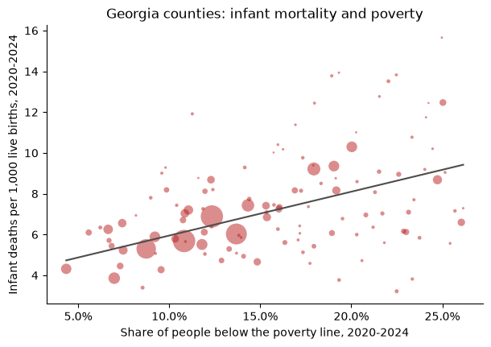

# Analyzing Georgia data

This article puts two datasets side by side: infant mortality from the
Georgia Department of Public Health and the poverty rate from the U.S.
Census. Infant mortality, the number of babies who die before their first
birthday per 1,000 live births, is one of the most widely used measures of a
community's health. The article shows the steps any such analysis needs.

```python
import matplotlib.pyplot as plt
import numpy as np
import pandas as pd
from matplotlib.ticker import PercentFormatter

import georgiacivicdata as gcd
```

## Pick the datasets

```python
gcd.search("infant mortality", n=3)[["name", "title", "year_min", "year_max"]]
```

```text
             name                                         title  year_min  year_max
0   infant_deaths      Infant Deaths and Infant Mortality Rates      2000      2025
1    fetal_deaths        Fetal Deaths and Fetal Mortality Rates      2000      2025
2  birth_outcomes  Birth Outcomes (Low Birthweight and Prete...      2000      2025
```

```python
gcd.search("poverty rate", level="counties", n=3)[["name", "title", "year_min", "year_max"]]
```

```text
                           name                                         title  year_min  year_max
0                       poverty                                 Poverty (ACS)      2020      2024
1           poverty_by_nativity     Poverty by Nativity and Citizenship (ACS)      2020      2024
2  low_income_low_access_tracts  Low-Income, Low-Access Tracts (USDA 2025 ...      2025      2025
```

`infant_deaths` holds infant deaths and live births from the state's OASIS
system, by county of residence; `poverty` is the American Community Survey
(ACS) 5-year estimate of the share of people below the federal poverty line.
Before joining them, check that they share a detail level and a key, and
which years they cover:

```python
infant_info = gcd.describe("infant_deaths")
poverty_info = gcd.describe("poverty")

print(
    "Shared detail levels:",
    sorted(set(infant_info.detail_levels) & set(poverty_info.detail_levels)),
)
print("Shared grain:", sorted(set(infant_info.grain) & set(poverty_info.grain)))
print("Infant deaths years:", min(infant_info.years), "-", max(infant_info.years))
print("Poverty years:", min(poverty_info.years), "-", max(poverty_info.years))
```

```text
Shared detail levels: ['counties', 'states']
Shared grain: ['county_fips', 'tract_geoid', 'year']
Infant deaths years: 2000 - 2025
Poverty years: 2020 - 2024
```

Both publish county rows keyed by `county_fips`. The ACS figures are 5-year
estimates named by their end year, so the 2024 vintage pools survey
responses from 2020 to 2024. We match it with the infant deaths of 2020 to
2024.

## Read the notes first

The dataset's notes say which columns can't be added up. Causes and ages at
death nest inside each other (`all` contains every cause, and `neonatal`
contains `early_neonatal`), so summing across them counts the same deaths
more than once:

```python
infant_info.notes["non_additive"]["column"].tolist()
```

```text
['cause', 'age_at_death']
```

Pinning both to `all` gives one row per county, year and group. The notes
also set a floor on any figure we compute ourselves:

```python
print(infant_info.notes["pooled_min_count"]["reason"].iloc[0])
```

```text
OASIS withholds rates based on 1-4 deaths (shown as * on OASIS), so no figure combined from fewer than 5 deaths is given.
```

## Pool infant mortality from counts

`gcd.columns()` names the numerator and denominator of the rate:

```python
cols = gcd.columns("infant_deaths")
cols.loc[cols["metric_component"].notna(), ["column", "metric_component"]]
```

```text
        column metric_component
11  num_deaths        numerator
12  num_births      denominator
```

```python
infant = gcd.rows(
    "infant_deaths",
    detail="counties",
    demographic="all",
    cause="all",
    age_at_death="all",
    year=range(2020, 2025),
    quiet=True,
)

pd.DataFrame(
    {
        "county_years": [len(infant)],
        "with_a_rate": [infant["death_rate_per_1k_births"].notna().sum()],
        "median_births": [infant["num_births"].median()],
    }
)
```

```text
   county_years  with_a_rate  median_births
0           795          385          258.0
```

Infant deaths are rare and most of Georgia's 159 counties are small. In a
typical county-year a few hundred babies are born and a single death moves
the rate by several points. That is why about half of the county-years have
no published rate at all. A county's rate over several years is the sum of
its deaths over the sum of its births, not the average of its yearly rates:

```python
pooled = (
    infant.groupby(["county_fips", "county_name"], as_index=False)
    .agg(deaths=("num_deaths", "sum"), births=("num_births", "sum"))
    .assign(infant_mortality=lambda d: 1000 * d["deaths"] / d["births"])
)

pooled.sort_values("births", ascending=False).head(10)
```

```text
    county_fips county_name  deaths  births  infant_mortality
66        13135    Gwinnett     323   56843          5.682318
59        13121      Fulton     389   56491          6.886053
43        13089      DeKalb     299   49609          6.027132
32        13067        Cobb     229   43244          5.295532
30        13063     Clayton     177   19212          9.212992
24        13051     Chatham     133   17899          7.430583
27        13057    Cherokee      59   15278          3.861762
68        13139        Hall      76   13787          5.512439
120       13245    Richmond     135   13110         10.297483
74        13151       Henry      77   13077          5.888201
```

```python
few = int((pooled["deaths"] < 5).sum())
print(f"Counties with fewer than five infant deaths in 2020-2024: {few}")
```

```text
Counties with fewer than five infant deaths in 2020-2024: 41
```

Even pooled over five years, those counties had too few infant deaths for a
rate under the dataset's own rule. We keep their counts for the group sums
below but leave them out of any county-level figure.

Pooling and averaging give different answers whenever counties differ in
size. Here is the comparison with the published state rows:

```python
state = gcd.rows(
    "infant_deaths",
    detail="states",
    demographic="all",
    cause="all",
    age_at_death="all",
    year=range(2020, 2025),
    quiet=True,
)

pd.DataFrame(
    {
        "infant_mortality": [
            pooled["infant_mortality"].mean(),
            1000 * pooled["deaths"].sum() / pooled["births"].sum(),
            1000 * state["num_deaths"].sum() / state["num_births"].sum(),
        ],
        "births": pd.array(
            [None, pooled["births"].sum(), state["num_births"].sum()], dtype="Int64"
        ),
    },
    index=["mean of county rates", "pooled from county counts", "state rows"],
)
```

```text
                           infant_mortality  births
mean of county rates               6.939697    <NA>
pooled from county counts          6.651060  623660
state rows                         6.651060  623660
```

The counties add up to the state row exactly, so the rate pooled from county
counts matches the state's. The plain mean of county rates is further off,
because it weighs a county with a hundred births like one with fifty
thousand.

## Join the poverty rate

```python
poverty = gcd.rows(
    "poverty",
    detail="counties",
    year=2024,
    race_iteration="all",
    quiet=True,
)[["county_fips", "poverty_rate", "poverty_rate_moe"]]

joined = pooled.merge(poverty, on="county_fips", how="inner")
len(joined)
```

```text
159
```

The ACS reports a 90% margin of error beside each estimate; for small
counties it can be a sizable share of the estimate:

```python
moe_share = joined["poverty_rate_moe"] / joined["poverty_rate"]
pd.Series({"median_moe_share": moe_share.median(), "max_moe_share": moe_share.max()})
```

```text
median_moe_share    0.190001
max_moe_share       0.507069
dtype: float64
```

```python
rated = joined[joined["deaths"] >= 5]

x = rated["poverty_rate"].to_numpy(dtype=float)
y = rated["infant_mortality"].to_numpy(dtype=float)
w = rated["births"].to_numpy(dtype=float)
slope, intercept = np.polyfit(x, y, 1, w=np.sqrt(w))

fig, ax = plt.subplots(figsize=(7, 4.5))
ax.scatter(x, y, s=w / w.max() * 400, alpha=0.5, color="#b91c1c", edgecolor="none")
grid = np.linspace(x.min(), x.max(), 50)
ax.plot(grid, intercept + slope * grid, color="0.3")
ax.xaxis.set_major_formatter(PercentFormatter(1))
ax.set_xlabel("Share of people below the poverty line, 2020-2024")
ax.set_ylabel("Infant deaths per 1,000 live births, 2020-2024")
ax.set_title("Georgia counties: infant mortality and poverty")
ax.spines[["top", "right"]].set_visible(False)
plt.show()
```



Each point is a county with at least five infant deaths in 2020-2024, sized
by its births; the line is a straight-line fit weighted by births.

```python
# Spearman's rank correlation: the correlation of the ranks
round(float(rated["poverty_rate"].rank().corr(rated["infant_mortality"].rank())), 2)
```

```text
0.37
```

County by county the association is modest, partly because even five-year
rates in small counties carry a lot of chance variation. Grouping counties
by their poverty rate and pooling each group's counts gives steadier rates.
Every county counts here, including those with too few deaths for a rate of
their own:

```python
thirds = joined.assign(
    poverty_group=pd.qcut(
        joined["poverty_rate"], 3, labels=["Lowest third", "Middle third", "Highest third"]
    )
)

(
    thirds.groupby("poverty_group", observed=True)
    .agg(counties=("county_fips", "size"), deaths=("deaths", "sum"), births=("births", "sum"))
    .assign(infant_mortality=lambda d: 1000 * d["deaths"] / d["births"])
)
```

```text
               counties  deaths  births  infant_mortality
poverty_group                                            
Lowest third         53    2345  395522          5.928874
Middle third         53    1229  155432          7.906995
Highest third        53     574   72706          7.894809
```

Babies born in the middle and highest-poverty thirds of counties die before
their first birthday at a rate about a third higher than babies born in the
lowest-poverty third. The lowest-poverty third holds most of the state's
births, so it sets the state's rate.

## What these figures can't tell

- **Association, not causation.** Poverty is one of many ways counties
  differ; nothing here says a county's poverty rate causes infant deaths.
- **Counties are not families.** A county's poverty rate describes all of
  its residents, not the families of the babies born there.
- **Estimates carry error.** The ACS poverty rate is a survey estimate with
  a margin of error, larger in small counties; a county near a group
  boundary could sit in either.
- **Small counts swing.** A county's rate on a few deaths says little on its
  own; group and pool before comparing places.
- **Infant mortality has many causes.** The dataset's `cause` and
  `age_at_death` filters split deaths into prematurity, birth defects,
  sudden infant death and others, which this article does not look at.
