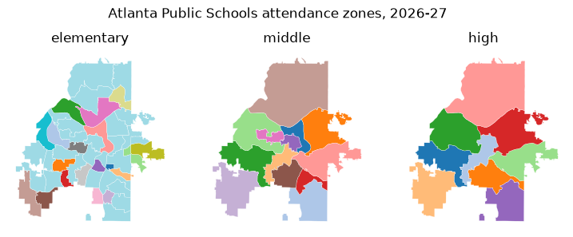

# School zones and places

Georgia Civic Data publishes school attendance zones: the areas that assign
a home to its zoned elementary, middle and high school. This article maps
one district's zones, checks which schools have no zone and how precise the
zones are, and finds the places a location falls in.

The geometry functions return geopandas `GeoDataFrame`s, so install the
`geo` extra (`pip install georgiacivicdata[geo]`) to map them. For plain
tables, use `geometry=False`.

```python
import matplotlib.pyplot as plt
import pandas as pd

import georgiacivicdata as gcd
```

## Map one district's zones

```python
zones = gcd.school_zones(district="Atlanta Public Schools")
zones.groupby(["zone_level", "method", "accuracy_class"]).size()
```

```text
zone_level  method        accuracy_class      
elementary  official_gis  authoritative_vector    45
high        official_gis  authoritative_vector     9
middle      official_gis  authoritative_vector    13
dtype: int64
```

```python
fig, axes = plt.subplots(1, 3, figsize=(9, 3.4))
for ax, level in zip(axes, ["elementary", "middle", "high"]):
    zones[zones["zone_level"] == level].plot(
        ax=ax, column="school_name", cmap="tab20", edgecolor="white", linewidth=0.2
    )
    ax.set_title(level)
    ax.set_axis_off()
fig.suptitle("Atlanta Public Schools attendance zones, 2026-27")
plt.show()
```



Each colour is a school. The default `resolution="display"` returns
simplified polygons for maps. `resolution="full"` returns the source
polygons, which are much larger; filter to a district before asking for
them.

## Schools without a zone

Charter, magnet, alternative and virtual schools have no attendance zone.
`gcd.school_zone_status()` says which schools have one and why the others
don't:

```python
status = gcd.school_zone_status(district="Atlanta Public Schools")
status.groupby(["zone_status", "no_zone_category"], dropna=False).size()
```

```text
zone_status  no_zone_category        
no_zone      alternative                  1
             charter                     16
             closed_or_consolidated       2
             magnet_or_choice             3
             residential_or_treatment     1
zoned        <NA>                        64
dtype: int64
```

```python
print(gcd.meta(status)["note"])
```

```text
Whether each school has an attendance zone on this platform and, if not, why. zoned says only that a zone is published here, not that it covers every grade the school teaches. Not an official enrollment determination: confirm with the school district.
```

## How precise are the zones?

Zones come from very different sources. Some are the district's official GIS
layers; others are digitized from PDF maps, rebuilt from street lists, or
are the whole district outline (in districts with one school per grade).
Every zone says how it was built (`method`) and how exact it is
(`accuracy_class`); treat them accordingly.

```python
coverage = gcd.school_zone_coverage()
pd.crosstab(coverage["level_status"], coverage["zone_level"])
```

```text
zone_level                elementary  high  middle
level_status                                      
not_available                     29     5      10
one_school_per_grade              82   130     115
partial                           10     6       9
served_by_other_district           0     1       0
zoned                             59    38      46
```

`gcd.school_zone_coverage()` gives one row per district and level, with the
share of the district's land and 2020 population its zones cover, and the
reason for anything short of complete:

```python
coverage.loc[
    coverage["district_name"] == "Appling County",
    ["zone_level", "level_status", "pct_population", "methods", "reason"],
]
```

```text
   zone_level          level_status  pct_population           methods  \
0  elementary         not_available             NaN  district_outline   
1      middle  one_school_per_grade             1.0  district_outline   
2        high  one_school_per_grade             1.0  district_outline   

                                                        reason  
0  Elementary: The district has separate elementary attenda...  
1  Elementary: The district has separate elementary attenda...  
2  Elementary: The district has separate elementary attenda...  
```

## Locate a place

`gcd.locate()` takes points (`lat`, `lon`) or street addresses and returns
the county, Census tract and block group, school district and zoned schools
each falls in, one row per place.

```python
landmarks = pd.DataFrame(
    {
        "landmark": [
            "Georgia State Capitol",
            "Stone Mountain Park",
            "Okefenokee Swamp Park",
            "Appling County Courthouse",
        ],
        "lat": [33.7490, 33.8053, 31.0558, 31.7782],
        "lon": [-84.3880, -84.1455, -82.2701, -82.3482],
    }
)
places = gcd.locate(lat=landmarks["lat"], lon=landmarks["lon"], id=landmarks["landmark"])
places[["id", "geographic_type", "geographic_id", "geographic_name", "grades"]]
```

```text
GCDAdvisory: A zone is the default assignment, not the only option: a Georgia student may attend another public school by transfer, or a charter, magnet or other choice school. See attendance_rules for the main ways.
```

```text
                           id    geographic_type geographic_id  \
0       Georgia State Capitol             county         13121   
1       Georgia State Capitol              tract   13121003500   
2       Georgia State Capitol        block_group  131210035001   
3       Georgia State Capitol    school_district           761   
4       Georgia State Capitol  elementary_school      761-0199   
5       Georgia State Capitol      middle_school      761-0199   
6       Georgia State Capitol        high_school      761-4560   
7         Stone Mountain Park             county         13089   
8         Stone Mountain Park              tract   13089021915   
9         Stone Mountain Park        block_group  130890219153   
10        Stone Mountain Park    school_district           644   
11        Stone Mountain Park  elementary_school      644-2068   
12        Stone Mountain Park      middle_school      644-0506   
13        Stone Mountain Park        high_school      644-0276   
14      Okefenokee Swamp Park             county         13299   
15      Okefenokee Swamp Park              tract   13299950900   
16      Okefenokee Swamp Park        block_group  132999509003   
17      Okefenokee Swamp Park    school_district           748   
18      Okefenokee Swamp Park  elementary_school      748-3050   
19      Okefenokee Swamp Park      middle_school      748-0295   
20      Okefenokee Swamp Park        high_school      748-0195   
21  Appling County Courthouse             county         13001   
22  Appling County Courthouse              tract   13001950301   
23  Appling County Courthouse        block_group  130019503012   
24  Appling County Courthouse    school_district           601   
25  Appling County Courthouse  elementary_school          <NA>   
26  Appling County Courthouse      middle_school      601-0195   
27  Appling County Courthouse        high_school      601-0103   

                                        geographic_name grades  
0                                                Fulton   <NA>  
1                                       Census Tract 35   <NA>  
2         Block Group 1, Census Tract 35, Fulton County   <NA>  
3                                Atlanta Public Schools   <NA>  
4                          Centennial Academy (Charter)    K-5  
5                          Centennial Academy (Charter)    6-8  
6                                   Midtown High School   9-12  
7                                                DeKalb   <NA>  
8                                   Census Tract 219.15   <NA>  
9     Block Group 3, Census Tract 219.15, DeKalb County   <NA>  
10                                        DeKalb County   <NA>  
11                     Stone Mountain Elementary School    K-5  
12                         Stone Mountain Middle School    6-8  
13                           Stone Mountain High School   9-12  
14                                                 Ware   <NA>  
15                                    Census Tract 9509   <NA>  
16        Block Group 3, Census Tract 9509, Ware County   <NA>  
17                                          Ware County   <NA>  
18                     Memorial Drive Elementary School    K-5  
19                               Waycross Middle School    6-8  
20                              Ware County High School   9-12  
21                                              Appling   <NA>  
22                                 Census Tract 9503.01   <NA>  
23  Block Group 2, Census Tract 9503.01, Appling County   <NA>  
24                                       Appling County   <NA>  
25                                                 <NA>   <NA>  
26                         Appling County Middle School    6-8  
27                           Appling County High School   9-12  
```

The output is long: filter it to the rows you need, such as
`places[places["geographic_type"] == "high_school"]`. A school's
`geographic_id` is its `"DISTRICT-SCHOOL"` code, the form `gcd.rows()` takes
as `school_id`.

The `note` column explains any row that is missing or needs care, such as a
level with no zone collected yet:

```python
noted = places[places["note"].notna()]
noted[["id", "geographic_type", "geographic_name"]]
```

```text
                           id    geographic_type geographic_name
25  Appling County Courthouse  elementary_school            <NA>
```

```python
import textwrap

for note in noted["note"]:
    print(textwrap.fill(note, width=76), end="\n\n")
```

```text
No elementary school zone has been collected for this district yet.
Elementary: The district has separate elementary attendance zones (the
Appling County Elementary Complex in Baxley, which is Appling County Primary
for pre-K to grade 3 and Appling County Elementary for grades 4-5; Altamaha
Elementary; and Fourth District Elementary in Surrency), but no map, street
list or online lookup of them is published.
```

### Addresses

Addresses are geocoded on your computer with the U.S. Census batch geocoder;
only the resulting coordinates are sent to Georgia Civic Data. Give one-line
addresses or a data frame with `street`, `city`, `state` and `zip`:

```python
capitol = gcd.locate(address="206 Washington St SW, Atlanta, GA 30334")
capitol[["match_status", "matched_address", "geographic_type", "geographic_name", "grades"]]
```

```text
i The server is busy (HTTP 502); retrying shortly.
```

```text
  match_status                           matched_address    geographic_type  \
0        match  206 WASHINGTON ST SW, ATLANTA, GA, 30334             county   
1        match  206 WASHINGTON ST SW, ATLANTA, GA, 30334              tract   
2        match  206 WASHINGTON ST SW, ATLANTA, GA, 30334        block_group   
3        match  206 WASHINGTON ST SW, ATLANTA, GA, 30334    school_district   
4        match  206 WASHINGTON ST SW, ATLANTA, GA, 30334  elementary_school   
5        match  206 WASHINGTON ST SW, ATLANTA, GA, 30334      middle_school   
6        match  206 WASHINGTON ST SW, ATLANTA, GA, 30334        high_school   

                                 geographic_name grades  
0                                         Fulton   <NA>  
1                                Census Tract 35   <NA>  
2  Block Group 1, Census Tract 35, Fulton County   <NA>  
3                         Atlanta Public Schools   <NA>  
4                   Centennial Academy (Charter)    K-5  
5                   Centennial Academy (Charter)    6-8  
6                            Midtown High School   9-12  
```

The same lookup for several buildings, from a data frame with one column per
address part. `id` carries each building's name into the output:

```python
buildings = pd.DataFrame(
    {
        "building": ["Georgia State Capitol", "Savannah City Hall"],
        "street": ["206 Washington St SW", "2 E Bay St"],
        "city": ["Atlanta", "Savannah"],
        "state": ["GA", "GA"],
        "zip": ["30334", "31401"],
    }
)
located = gcd.locate(address=buildings, id=buildings["building"], quiet=True)
located.loc[
    located["geographic_type"] == "high_school",
    ["id", "match_status", "geographic_name", "grades"],
]
```

```text
                       id match_status                                 geographic_name grades
6   Georgia State Capitol        match                             Midtown High School   9-12
13     Savannah City Hall        match  The School Of Liberal Studies At Savannah High   9-12
```

### Overlapping school zones

Some residences are zoned to one elementary school for the early grades and
another for the later ones. In this case, a level has more than one school
row and `grades` tells them apart. City Schools of Decatur, for example,
splits elementary schools between K-2 and 3-5, so some homes in the district
show two elementary schools:

```python
oakhurst = gcd.dimension(
    "schools",
    district_code="773",
    q="Oakhurst",
    active=True,
    columns=["school_name", "latitude", "longitude"],
)
oakhurst
```

```text
                  school_name  latitude  longitude
0  Oakhurst Elementary School   33.7637    -84.306
```

```python
split = gcd.locate(lat=oakhurst["latitude"], lon=oakhurst["longitude"], quiet=True)
split.loc[
    split["geographic_type"].str.endswith("_school"),
    ["geographic_type", "geographic_id", "geographic_name", "grades"],
]
```

```text
     geographic_type geographic_id                       geographic_name grades
4  elementary_school      773-0105            Oakhurst Elementary School    K-2
5  elementary_school      773-0112  Fifth Avenue Upper Elementary School    3-5
6      middle_school      773-1552             Beacon Hill Middle School    6-8
7        high_school      773-3050                   Decatur High School   9-12
```

`grade` keeps only the school for one grade:

```python
one_grade = gcd.locate(lat=oakhurst["latitude"], lon=oakhurst["longitude"], grade=4, quiet=True)
one_grade.loc[
    one_grade["geographic_type"].str.endswith("_school"),
    ["geographic_type", "geographic_name", "grades"],
]
```

```text
     geographic_type                       geographic_name grades
4  elementary_school  Fifth Avenue Upper Elementary School    3-5
```

### The default assignment

A zone is the default assignment, not the only option:

```python
print(gcd.meta(capitol)["assignment_note"])
```

```text
A zone is the default assignment, not the only option: a Georgia student may attend another public school by transfer, or a charter, magnet or other choice school. See attendance_rules for the main ways.
```

Students can attend another public school by transfer, or a charter, magnet,
or other choice school option. See Georgia Civic Data's article [School
Zones and School Choice in
Georgia](https://georgiacivicdata.org/stories/school-attendance-rules) for
more information.
