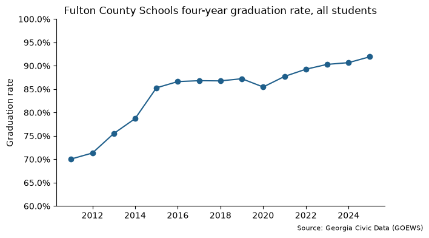
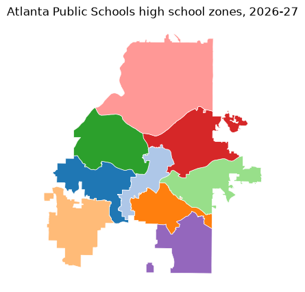

# georgiacivicdata

`georgiacivicdata` brings Georgia's public data into Python. It is the
Python client for the API run by [Georgia Civic Data](https://georgiacivicdata.org).

Georgia Civic Data gathers, organizes, and standardizes Georgia's public
data, helping residents, parents, researchers, and professionals find
answers in data that is already theirs. Every dataset has the same shape,
with the same codes for counties, school districts, schools and demographic
groups, so datasets from different agencies can be compared and joined.

The data covers education, Census, health, and immigration. Geographic
detail spans from the whole state down to single schools and Census tracts.
Each dataset comes with a data contract that documents its source, its
columns, and the limits of the data.

With `georgiacivicdata` you can:

- Find Georgia datasets, read the documentation, and get rows, all from
  Python.
- Get **pandas or Polars** data frames with consistent column types: codes
  stay text so leading zeros survive, years are integers, and rates are
  proportions between 0 and 1.
- See every school, district, and county code with its name, and filter by
  name instead of code.
- Get school attendance zones and district boundaries as geopandas
  `GeoDataFrame`s, ready to map.
- Look up the schools zoned for any Georgia address.

There is no API key and nothing to configure. The same functions exist in
the [R package](https://georgiacivicdata.org/r/), with a `gcd_` prefix.

#### TIP
**For LLM agents:** every page of this site has a Markdown version. Add
`.md` to a page's address, or start at
[llms.txt](https://georgiacivicdata.org/py/llms.txt). See
[For LLM agents](https://georgiacivicdata.org/py/agents.md).

## Installation

Install the package from PyPI:

```bash
pip install georgiacivicdata
```

The `polars` extra adds Polars output and the `geo` extra adds geopandas for
maps:

```bash
pip install "georgiacivicdata[polars,geo]"
```

Or install the development version from GitHub:

```bash
pip install "georgiacivicdata @ git+https://github.com/shanejorr/georgia-data-pypackage"
```

## Example: graduation rates in Fulton County

This walkthrough answers one question from start to finish: how has the
high school graduation rate in Fulton County Schools changed over time? It
follows the usual workflow:

- Find a dataset: `gcd.search()` or `gcd.datasets()`.
- Learn what is in it: `gcd.columns()` and `gcd.describe()`.
- Download the data: `gcd.rows()`.
- Plot it: any Python plotting tool, such as matplotlib.

### Step 1: find the right dataset

Every dataset has a short name, such as `graduation_rate_4_year_cohort`, and
you need that name to get data. If you don't know it, `gcd.search()`
searches the catalog in plain words. It matches both keywords and meaning, so
you don't need the exact wording of a dataset's title. Each result has the
dataset's `name`, `title`, and the first and last years it covers.

```python
import georgiacivicdata as gcd

gcd.search("high school graduation", n=5)[["name", "title", "year_min", "year_max"]]
```

```text
GCDAdvisory: Lookup tables that match: 'schools', 'districts'. See gcd.dimension().
```

```text
                            name                                         title  year_min  year_max
0          ccrpi_graduation_rate                  High School Graduation Rates      2012      2025
1  graduation_rate_4_year_cohort              Four-Year Cohort Graduation Rate      2004      2025
2         high_school_completers                        High School Completers      2011      2025
3              postsecondary_c11  Postsecondary Enrollment of HS Graduates ...      2010      2023
4              postsecondary_c12  Postsecondary Outcomes of HS Graduates (C...      2008      2021
```

The four-year cohort graduation rate, `graduation_rate_4_year_cohort`, is
the one we want: the share of students who graduate within four years of
starting ninth grade. `gcd.datasets()` lists the whole catalog, for browsing
instead of searching.

### Step 2: learn what is in it

Check what a dataset holds before downloading it. `gcd.columns()` lists its
columns with each one's type, role (a year, a place, a demographic group, or
a measured value), and unit.

```python
cols = gcd.columns("graduation_rate_4_year_cohort")[["column", "type", "role", "unit"]]
cols.head()
```

```text
               column     type         role  unit
0                year  integer         year  <NA>
1       district_code   string  fk_district  <NA>
2       district_name   string        label  <NA>
3  district_census_id   string        label  <NA>
4       district_type   string        label  <NA>
```

Each row is one year, one place and one demographic group. The measured
values are the columns whose role is `metric`:

```python
cols[cols["role"] == "metric"]
```

```text
             column     type    role        unit
10    num_graduates  integer  metric       count
11       num_cohort  integer  metric       count
12  graduation_rate   number  metric  proportion
```

The value we want is `graduation_rate`, a proportion on the 0-1 scale, so
0.9 means 90%.

`gcd.describe()` prints the rest of the dataset's documentation: its source,
the years and detail levels it covers, and notes on how to use it. Those
notes matter here. Georgia changed how it calculates the graduation rate in
2011, so the rates before and after 2011 are not comparable. We start the
series in 2011.

### Step 3: get the rows

`gcd.rows()` downloads a dataset's rows as a data frame. Filters narrow the
request:

- `district` takes a district's name and turns it into the district code for
  you (`district_code` takes the code directly).
- `detail="districts"` asks for district-wide figures rather than one row
  per school.
- `demographic` picks the student groups; `"all"` is every student.
- `year` picks the years: `range(2011, 2026)` is 2011 to 2025.

```python
grads = gcd.rows(
    "graduation_rate_4_year_cohort",
    district="Fulton County",
    detail="districts",
    demographic=["all", "black", "hispanic", "white"],
    year=range(2011, 2026),
)
grads.head()
```

```text
GCDAdvisory: This result contains NULL metric cells, which mean the value was SUPPRESSED (small counts), not zero — do not report or chart a NULL as 0 (see null_semantics and each column's null_meaning).
GCDAdvisory: Demographic groups overlap across categories and may overlap within a category (active_duty can be a subset of military_connected). Read the dataset's definitions and non_additive declarations. Use the published `all` total when available, never add it to its subgroups. Counts reconcile only for complete, disjoint groups; subgroup rates generally do not add to the overall rate.
GCDAdvisory: `district_census_id` is a 5-digit Census school-district code, NOT a county FIPS, and a district is not 1:1 with a county — do not map these district rows as counties.
```

```text
   year district_code  district_name district_census_id district_type  ... demographic_label  \
0  2011           660  Fulton County              02280      standard  ...               All   
1  2011           660  Fulton County              02280      standard  ...             Black   
2  2011           660  Fulton County              02280      standard  ...          Hispanic   
3  2011           660  Fulton County              02280      standard  ...             White   
4  2012           660  Fulton County              02280      standard  ...               All   

  demographic_category num_graduates  num_cohort  graduation_rate  
0            aggregate          5396        7703           0.7005  
1                 race          2057        3536           0.5817  
2                 race           364         671           0.5425  
3                 race          2343        2707           0.8655  
4            aggregate          5233        <NA>           0.7134  

[5 rows x 11 columns]
```

`grads.head()` shows the first five rows. Each place comes back with both its code and its name, and each demographic
code with a readable label. The API also sends advisories, shown as
`GCDAdvisory` warnings. Here they warn that the `all` total sits beside the
subgroups, so never add a total to its subgroups. A missing value usually
means the figure was **suppressed** to protect small groups, not that it is
zero.

### Step 4: plot the overall rate

The result is an ordinary data frame. To plot the overall rate over time,
keep the rows where `demographic` is `"all"` and draw a line.

```python
import matplotlib.pyplot as plt
from matplotlib.ticker import PercentFormatter

grads_all = grads[grads["demographic"] == "all"]

fig, ax = plt.subplots(figsize=(7, 4))
ax.plot(grads_all["year"], grads_all["graduation_rate"], marker="o", color="#1f5f8b")
ax.yaxis.set_major_formatter(PercentFormatter(1))
ax.set_ylim(0.6, 1)
ax.set_title("Fulton County Schools four-year graduation rate, all students")
ax.set_ylabel("Graduation rate")
ax.spines[["top", "right"]].set_visible(False)
fig.text(0.99, 0.01, "Source: Georgia Civic Data (GOEWS)", ha="right", fontsize=8)
plt.show()
```



### pandas or Polars

pandas is the default. Every table function takes `backend="polars"`, and
`gcd.set_option("backend", "polars")` switches the whole session:

```python
gcd.rows(
    "graduation_rate_4_year_cohort",
    district="Fulton County",
    detail="districts",
    demographic="all",
    year=range(2023, 2026),
    quiet=True,
    backend="polars",
)
```

```text
shape: (3, 11)
┌──────┬────────────┬────────────┬────────────┬───┬────────────┬───────────┬───────────┬───────────┐
│ year ┆ district_c ┆ district_n ┆ district_c ┆ … ┆ demographi ┆ num_gradu ┆ num_cohor ┆ graduatio │
│ ---  ┆ ode        ┆ ame        ┆ ensus_id   ┆   ┆ c_category ┆ ates      ┆ t         ┆ n_rate    │
│ i64  ┆ ---        ┆ ---        ┆ ---        ┆   ┆ ---        ┆ ---       ┆ ---       ┆ ---       │
│      ┆ str        ┆ str        ┆ str        ┆   ┆ str        ┆ i64       ┆ i64       ┆ f64       │
╞══════╪════════════╪════════════╪════════════╪═══╪════════════╪═══════════╪═══════════╪═══════════╡
│ 2023 ┆ 660        ┆ Fulton     ┆ 02280      ┆ … ┆ aggregate  ┆ 6815      ┆ 7547      ┆ 0.903     │
│      ┆            ┆ County     ┆            ┆   ┆            ┆           ┆           ┆           │
│ 2024 ┆ 660        ┆ Fulton     ┆ 02280      ┆ … ┆ aggregate  ┆ 6977      ┆ 7695      ┆ 0.9067    │
│      ┆            ┆ County     ┆            ┆   ┆            ┆           ┆           ┆           │
│ 2025 ┆ 660        ┆ Fulton     ┆ 02280      ┆ … ┆ aggregate  ┆ 7294      ┆ 7934      ┆ 0.9193    │
│      ┆            ┆ County     ┆            ┆   ┆            ┆           ┆           ┆           │
└──────┴────────────┴────────────┴────────────┴───┴────────────┴───────────┴───────────┴───────────┘
```

## Lookup tables

Datasets hold codes and figures, with place names added. Everything else
known about a place lives in shared lookup tables, called dimensions: a
district's type, a school's level, grade span, locale (city, suburb, town or
rural), charter status, address and coordinates, and a Census tract's land
area and population. `gcd.dimension()` returns one as a data frame, with the
same name filters as `gcd.rows()`.

Lookup tables help you:

- Browse what exists before you request data, such as every active high
  school in a district.
- Add attributes the datasets don't carry, then filter or group by them.
- Map schools with their coordinates.

Here are the first five active high schools in Fulton County with their
locale:

```python
gcd.dimension(
    "schools",
    district="Fulton County",
    school_level="high",
    active=True,
    columns=["district_code", "school_code", "school_name", "locale"],
).head()
```

```text
  district_code school_code                       school_name  locale
0           660        0106                Milton High School  suburb
1           660        0118  Hapeville Charter Career Academy  suburb
2           660        0119             Cambridge High School  suburb
3           660        0176              Banneker High School  suburb
4           660        0191               Roswell High School    city
```

To compare graduation rates by locale, merge the locale into school-level
graduation rates. School codes repeat across districts, so merge on
`district_code` and `school_code` together.

```python
schools = gcd.dimension(
    "schools",
    district="Fulton County",
    columns=["district_code", "school_code", "locale"],
)

school_grads = gcd.rows(
    "graduation_rate_4_year_cohort",
    district="Fulton County",
    detail="schools",
    demographic="all",
    year=2025,
    quiet=True,
)

school_grads = school_grads.merge(schools, on=["district_code", "school_code"])
school_grads.groupby("locale")["graduation_rate"].median()
```

```text
locale
city      0.95080
rural     0.94330
suburb    0.96585
Name: graduation_rate, dtype: float64
```

Fulton County has only two rural high schools, so treat this as an
illustration, not a finding.

## School zones and places

`gcd.school_zones()` returns school attendance zones as a geopandas
`GeoDataFrame`, ready to map. This map shows the high school zones in
Atlanta Public Schools:

```python
zones = gcd.school_zones(district="Atlanta Public Schools", zone_level="high")

ax = zones.plot(
    column="school_name", edgecolor="white", linewidth=0.5, figsize=(6, 5), cmap="tab20"
)
ax.set_title("Atlanta Public Schools high school zones, 2026-27")
ax.set_axis_off()
plt.show()
```



`gcd.locate()` goes the other way: give it an address or a point, and it
returns the places that contain it, including the county, Census tract,
school district and zoned schools. Addresses are geocoded on your computer
with the U.S. Census geocoder, so only the point reaches the Georgia Civic
Data API.

```python
# The Georgia State Capitol
capitol = gcd.locate(address="206 Washington St SW, Atlanta, GA 30334")
capitol[["geographic_type", "geographic_id", "geographic_name", "grades"]].head()
```

```text
GCDAdvisory: A zone is the default assignment, not the only option: a Georgia student may attend another public school by transfer, or a charter, magnet or other choice school. See attendance_rules for the main ways.
```

```text
     geographic_type geographic_id                               geographic_name grades
0             county         13121                                        Fulton   <NA>
1              tract   13121003500                               Census Tract 35   <NA>
2        block_group  131210035001  Block Group 1, Census Tract 35, Fulton Co...   <NA>
3    school_district           761                        Atlanta Public Schools   <NA>
4  elementary_school      761-0199                  Centennial Academy (Charter)    K-5
```

The first five rows are shown; the rest are the zoned middle and high
schools.

## Data license and citation

The data is published under the [Creative Commons Attribution 4.0
International license (CC BY 4.0)](https://creativecommons.org/licenses/by/4.0/):
credit Georgia Civic Data and the original source. `gcd.citation()` writes
the citation for any result:

```python
gcd.citation(grads)
```

```text
"Four-Year Cohort Graduation Rate. Georgia Civic Data (georgiacivicdata.org), CC BY 4.0. https://georgiacivicdata.org/api/v1/datasets/graduation_rate_4_year_cohort. Original source: Governor's Office of Education and Workforce Strategy (GOEWS, formerly GOSA)."
```

The package code is MIT-licensed.

## Learn more

- [Get started](https://georgiacivicdata.org/py/articles/get-started.md): the catalog, names and filters,
  and the rules of the data that are easy to get wrong.
- [Analyzing Georgia data](https://georgiacivicdata.org/py/articles/analysis.md): joining two datasets
  and pooling rates from their counts.
- [School zones and places](https://georgiacivicdata.org/py/articles/school-zones.md): maps, zone status
  and locating points and addresses.
- [Reference](https://georgiacivicdata.org/py/reference.md): every function.
- Georgia Civic Data: [https://georgiacivicdata.org](https://georgiacivicdata.org)
- API documentation: [https://georgiacivicdata.org/docs](https://georgiacivicdata.org/docs)
